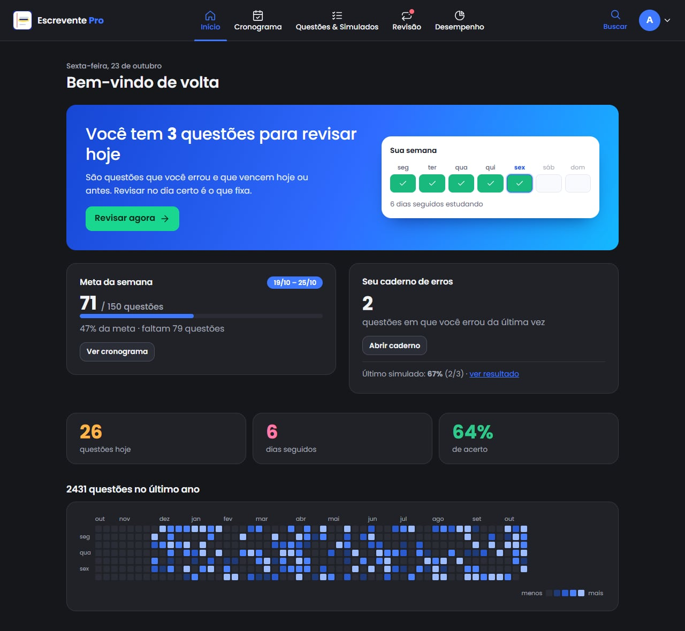
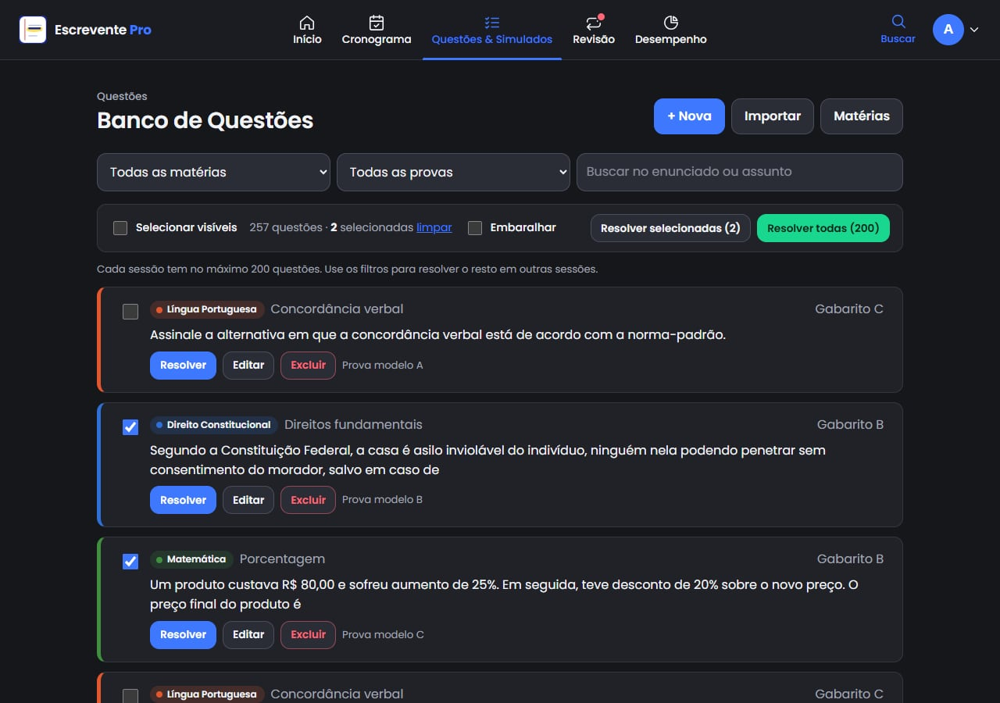
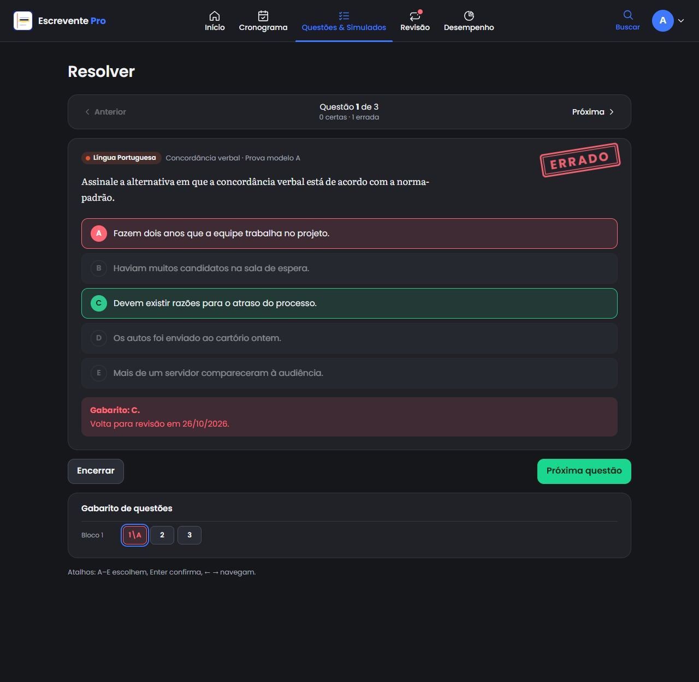
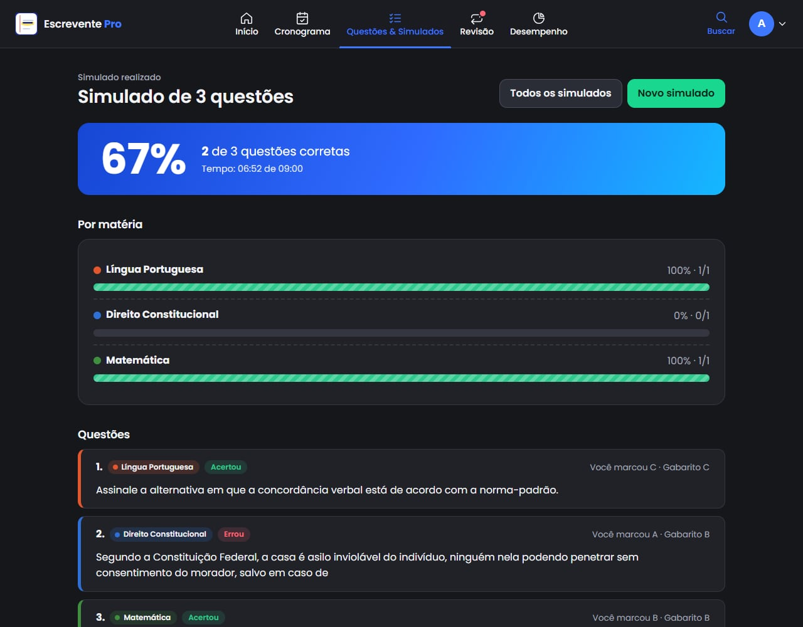
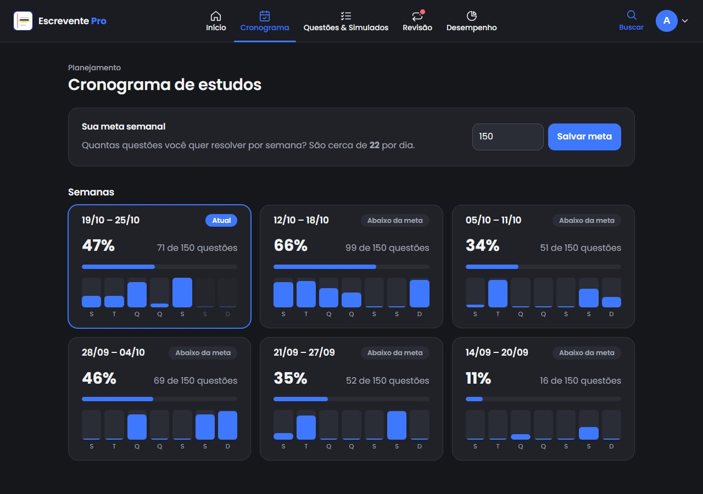
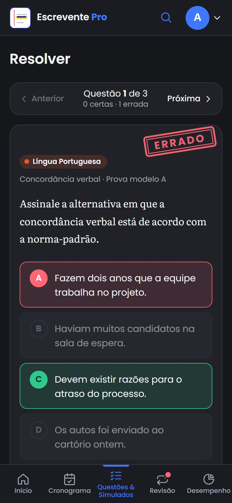
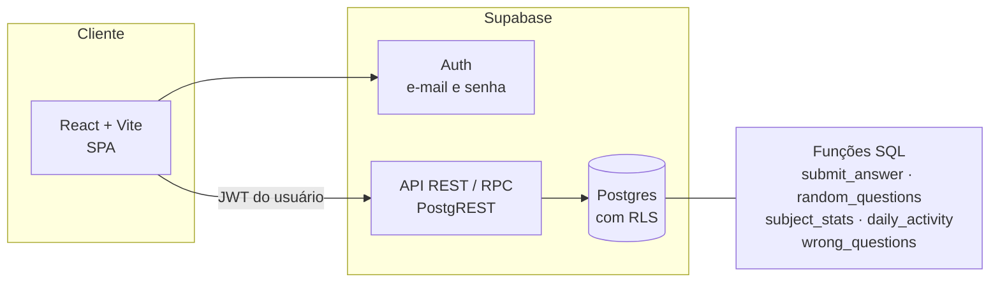

# Escrevente Pro

Plataforma web de estudos para o concurso de **Escrevente Técnico Judiciário do TJSP** (banca VUNESP): banco de questões próprio, revisão espaçada, simulados cronometrados e acompanhamento de constância.

Projeto pessoal de uso diário, desenvolvido também como exercício de **backend de verdade**: modelagem relacional, segurança no nível do banco (Row Level Security), regras de negócio em funções SQL e migrations versionadas.

> Este repositório existe para **documentar** o projeto: o que foi construído, como é organizado e por que as decisões foram tomadas. Não é um template nem um produto para instalação.



## O problema

Estudar para concurso exige três coisas que plataformas genéricas resolvem mal:

1. **Fazer questões da própria banca**, em volume, filtrando por matéria e prova.
2. **Revisar o que se errou no dia certo**, em vez de reler tudo.
3. **Manter constância**, enxergando semana a semana se a meta está sendo cumprida.

O Escrevente Pro junta as três coisas num app que funciona bem no celular (onde a maior parte do estudo acontece) e no computador.

## Telas

| Banco de questões | Resolvendo uma questão |
|---|---|
|  |  |

| Resultado de simulado | Cronograma semanal |
|---|---|
|  |  |

| Celular: início | Celular: questão |
|---|---|
|  |  |

> As capturas usam questões de exemplo escritas para a documentação. O conteúdo real das provas não faz parte do repositório.

## Funcionalidades

**Estudo**
- **Banco de questões** de múltipla escolha (A–E) com matéria, assunto e fonte, além de busca e filtros por matéria e por prova.
- **Escolher e resolver**: marcar questões, resolver as filtradas ou seguir "a partir desta".
- **Resolver por sorteio**, com matérias e quantidade à escolha.
- **Navegação Anterior/Próxima** com grade de gabarito por blocos e atalhos de teclado.
- **Simulados cronometrados**: marcação sem correção imediata, nota ao final, resultado por matéria e histórico.

**Memória e constância**
- **Revisão espaçada** (SM-2 simplificado): o que se erra volta em 1, 3, 8, 21… dias.
- **Caderno de erros**: questões cuja última resposta foi errada; ao acertar, saem do caderno.
- **Cronograma** com meta semanal de questões e progresso das últimas semanas.
- **Mapa de calor** anual e sequência de dias estudados.
- **Painel de desempenho** por matéria, destacando as mais fracas.

**Gestão do banco**
- Cadastro e edição de questões, matérias editáveis por usuário.
- **Importação em massa** por planilha `.xlsx`/`.csv` com prévia e relatório de erros por linha.
- Ferramenta de linha de comando que converte provas anteriores em PDF para a planilha de importação (ver [origem das questões](docs/banco-de-questoes.md)).

**Experiência**
- Mobile-first, com menu superior no computador e barra de abas no celular.
- Tema escuro (padrão), claro ou automático.
- Instalável na tela inicial do celular (PWA básico, sem modo offline).

## Arquitetura em uma imagem



O navegador conversa direto com o Supabase usando apenas a chave pública. **Quem garante o isolamento entre usuários é o banco**, e não o código do frontend. Detalhes em [docs/arquitetura.md](docs/arquitetura.md) e [docs/banco-de-dados.md](docs/banco-de-dados.md).

## Stack

| Camada | Tecnologia |
|---|---|
| Interface | React 19, Vite, React Router, CSS Modules (JavaScript) |
| Backend | Supabase: Auth, Postgres, Row Level Security, funções SQL (RPC) |
| Planilhas | SheetJS, carregado sob demanda só na tela de importação |
| Ferramentas | Node.js (conversão de provas), pdf.js |
| Execução | Uso pessoal, em ambiente local (servidor de desenvolvimento do Vite) |
| Fase 2 (planejada) | API de IA via Supabase Edge Functions |

## Decisões de projeto

- **Segurança no banco.** Toda tabela tem `user_id` e Row Level Security. Chaves estrangeiras compostas `(id, user_id)` impedem que uma linha aponte para dados de outro usuário, mesmo que alguém chame a API diretamente.
- **Regras de negócio em funções SQL.** `submit_answer` confere o gabarito, grava a tentativa e atualiza a revisão espaçada numa única transação. O navegador nunca decide se acertou.
- **Agregações no banco.** Estatísticas e mapa de calor são `GROUP BY` no Postgres, em vez de baixar o histórico inteiro para o celular. Datas usam o fuso `America/Sao_Paulo`, para uma resposta às 22h não "virar" o dia seguinte por causa do UTC.
- **Sorteio no banco.** `random_questions` usa `ORDER BY random()`, sem trazer o banco inteiro.
- **Migrations versionadas.** O schema vive em `supabase/migrations/`, no Git, e não em cliques no painel.
- **Camada de serviços.** Páginas não chamam o banco diretamente: tudo passa por `src/services/`.
- **Build estático e portátil.** O app é uma SPA sem servidor próprio: todo o backend é o Supabase. O build aceita `base` configurável e gera um `404.html` de fallback, o que o deixa pronto para qualquer hospedagem estática, embora hoje seja usado apenas localmente.
- **Importação com validação em duas etapas.** O arquivo é lido e validado no navegador, com prévia e erros por linha, antes de qualquer gravação.

### Revisão espaçada em duas linhas

Algoritmo SM-2 simplificado para acerto/erro (sem nota de 0 a 5). Errou: volta amanhã e o fator de facilidade cai. Acertou uma questão da fila: 3 dias, depois intervalo anterior × fator, com teto de 60 dias porque a prova tem data marcada. Explicação completa em [docs/banco-de-dados.md](docs/banco-de-dados.md#revisão-espaçada).

## Segurança e privacidade

- A chave exposta no navegador é a **pública** (anon/publishable). Ela só funciona dentro das regras do RLS.
- Nenhuma chave secreta está no código nem no histórico. Variáveis ficam fora do repositório.
- A chave de qualquer serviço de IA ficará apenas em *secrets* de Edge Functions, nunca no frontend.
- Questões de provas pertencem às bancas e **não são publicadas aqui**: ficam apenas no banco privado do usuário.

## Organização do código

```
src/
  components/   Layout (menu superior), QuizRunner, Heatmap, StatBar, Menu…
  contexts/     Autenticação e tema
  lib/          Cliente Supabase, datas (fuso SP), cores por matéria, parser de importação
  pages/        Telas: início, banco, resolver, simulados, caderno, cronograma…
  services/     Toda a comunicação com o Supabase
supabase/migrations/   Schema, RLS e funções SQL
scripts/               Conversão de provas em PDF e verificações do parser
docs/                  Documentação detalhada
```

## Qualidade

- As regras do banco (revisão espaçada, isolamento entre usuários, caderno de erros, simulados) foram validadas durante o desenvolvimento em um Postgres local, simulando usuários distintos e as políticas de RLS.
- O parser de importação e o parser de provas têm verificações automatizadas em `scripts/`.
- Não há ainda suíte de testes automatizados da interface; está no roadmap.

## Roadmap

- Explicação por IA de cada questão (o gabarito e o erro cometido)
- Geração de questões no estilo da banca a partir de trechos de lei, com revisão manual obrigatória antes de salvar
- Resumo semanal gerado por IA com os assuntos mais errados
- Filtro de questões "ainda não resolvidas" e ordem original da prova
- Testes automatizados de interface e do banco

## Direitos

Código disponibilizado para consulta como documentação de portfólio. **Todos os direitos reservados**: não há licença para cópia, redistribuição ou uso comercial sem autorização do autor.
