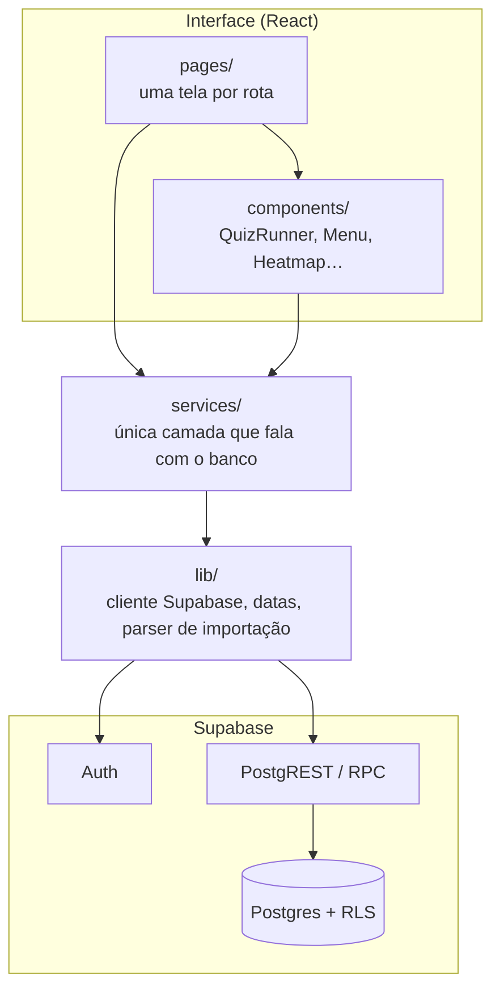
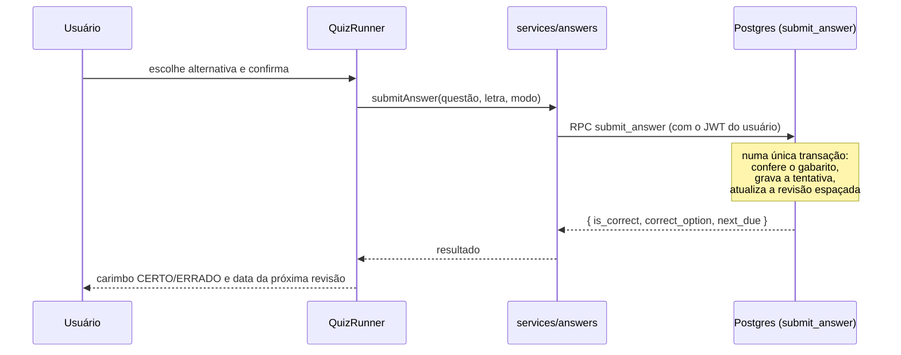

# Arquitetura

Visão de como o Escrevente Pro é organizado e por que.

## Camadas

- **`pages/`** compõe telas e cuida de estado local (carregando, erro, filtros).
- **`components/`** reúne peças reutilizáveis. O mais importante é o `QuizRunner`, que serve a quatro situações: resolver por sorteio, revisão do dia, caderno de erros/seleção do banco e simulado (modo `exam`, com cronômetro e sem correção imediata).
- **`services/`** é a fronteira com o backend. Nenhuma página chama `supabase.from(...)` direto. Se o backend mudasse, só essa pasta mudaria.
- **`lib/`** guarda o que não é regra de tela: cliente Supabase, helpers de data no fuso de São Paulo, cores por matéria, sessão de estudo e o parser da importação.

## Fluxo de uma resposta

O ponto central do app é responder uma questão. O navegador nunca decide se acertou.

Fazer isso numa função SQL evita estados inconsistentes: se a rede cair no meio, ou a tentativa e a revisão foram gravadas juntas, ou nenhuma delas.

## Autenticação e acesso a dados

- Login por e-mail e senha (Supabase Auth). A sessão fica no navegador e o token é renovado automaticamente.
- As rotas privadas ficam atrás de um `ProtectedRoute`. Isso é só conforto de navegação: **a segurança real é o RLS**, que continua valendo para qualquer chamada direta à API.
- A chave usada no navegador é a pública. Nenhum segredo existe no frontend.

## Navegação e hospedagem

- SPA com React Router. As rotas principais: início, cronograma, banco de questões (lista, nova, importar, resolver seleção), resolver, revisão, caderno, simulados (novo, histórico, resultado), desempenho e matérias.
- Hospedagem estática no GitHub Pages, publicada por GitHub Actions. Duas adaptações foram necessárias:
  1. o site vive em uma subpasta (`/nome-do-repositorio/`), então o Vite recebe um `base` e o roteador um `basename`;
  2. o Pages não conhece rotas do React, então o build copia `index.html` para `404.html`, e o roteador assume a rota.
- A variável `VITE_BASE`, as chaves públicas e o build ficam no workflow, não no código.

## Interface

- **Mobile-first.** No celular a navegação é uma barra de abas fixa embaixo (alcance do polegar); no computador vira um menu superior com um menu suspenso para "Questões & Simulados".
- **Tema** escuro (padrão), claro ou automático, guardado no navegador e aplicado antes da primeira pintura para não piscar.
- **Acessibilidade:** alvos de toque de pelo menos 44px, foco visível, estados também por texto e não só por cor, atalhos de teclado na questão (A–E, Enter, setas) e respeito a `prefers-reduced-motion`.
- **Identidade visual:** cada matéria tem uma cor fixa (etiquetas, filtros e barras), o carimbo CERTO/ERRADO dá retorno imediato, e a grade de gabarito mostra de relance o andamento da sessão.

## Desempenho

- A biblioteca de planilhas (SheetJS) só é baixada na tela de importação (importação dinâmica).
- Listas usam paginação por demanda ("Carregar mais") com ordem estável, para nunca repetir ou pular linhas entre páginas.
- Estatísticas, mapa de calor e sorteio rodam no banco, devolvendo só o resultado.

## Limitações conhecidas

- Não há modo offline (o PWA é só instalável).
- Questões com figura, gráfico ou tabela precisam ser cadastradas à mão, porque a extração dos PDFs só traz texto.
- Cada sessão de estudo tem no máximo 200 questões, por causa do tamanho das consultas.
