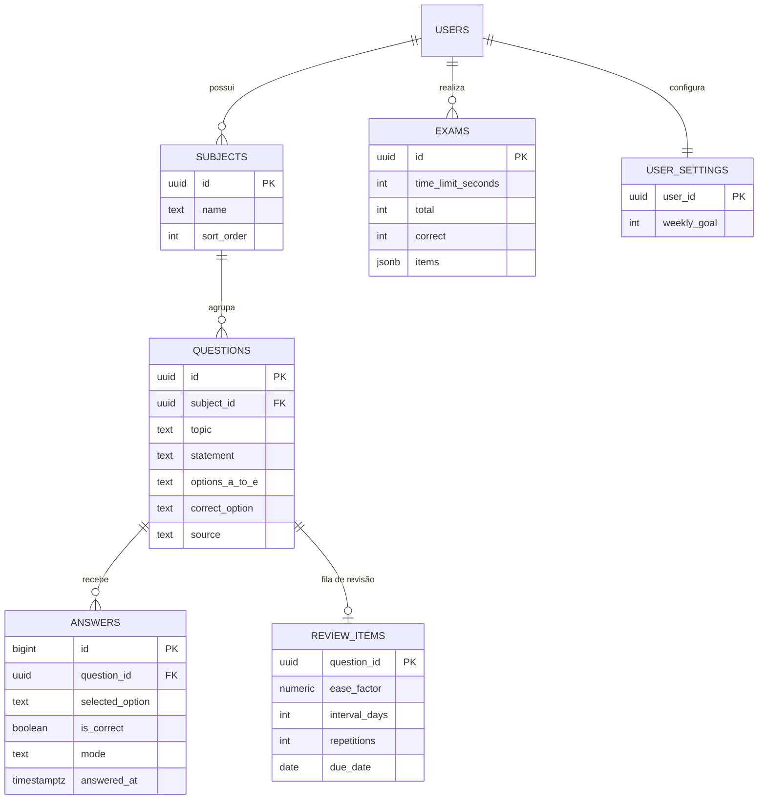

# Banco de dados

Postgres gerenciado pelo Supabase. O schema é definido apenas em migrations versionadas (`supabase/migrations/`).

## Modelo

Todas as tabelas têm `user_id` (com padrão `auth.uid()`) apontando para `auth.users`.

| Tabela | Papel |
|---|---|
| `subjects` | Matérias de cada usuário. Criadas automaticamente no cadastro (11 matérias do edital) e editáveis. `unique(user_id, name)`. |
| `questions` | Questão de múltipla escolha com 5 alternativas em colunas, gabarito (`check` A–E), assunto, fonte e `status` (`active`/`draft`, previsto para a fase de IA). |
| `answers` | Cada tentativa. Base do mapa de calor, do desempenho e do caderno de erros. `mode`: `practice`, `review` ou `exam`. |
| `review_items` | Estado da revisão espaçada: uma linha por questão que está na fila. |
| `exams` | Simulados realizados: resumo, tempo e um `jsonb` com `[{ q, sel, ok }]` por questão. |
| `user_settings` | Preferências por usuário (meta semanal de questões, entre 1 e 5000). |

**Por que 5 colunas e não uma tabela de alternativas?** As provas da banca têm sempre 5 alternativas fixas. Colunas mapeiam 1:1 com a planilha de importação e evitam JOINs. Uma tabela separada seria o caminho se o número de alternativas variasse.

## Segurança: RLS e chaves compostas

- **RLS ligado em todas as tabelas**, com a mesma política: `user_id = (select auth.uid())`. O `select` em volta faz o Postgres avaliar o valor uma vez por consulta, e não uma vez por linha.
- **Chaves estrangeiras compostas** `(question_id, user_id) → questions(id, user_id)` (e equivalentes para matéria). Assim, nem sabendo o `uuid` de uma matéria de outra pessoa é possível ligar uma questão a ela.
- `on delete restrict` em `questions.subject_id`: não se apaga uma matéria que ainda tem questões. `on delete cascade` em respostas e revisão: apagar uma questão limpa o histórico dela.
- Permissões explícitas: somente o papel `authenticated` acessa as tabelas e as funções; `anon` e `public` não.

## Funções SQL (RPC)

| Função | O que faz |
|---|---|
| `submit_answer(question, option, mode)` | Confere o gabarito, grava a tentativa e atualiza `review_items` numa transação. Devolve `{ is_correct, correct_option, next_due }`. |
| `random_questions(subjects[], limit)` | Sorteia questões ativas no banco (`ORDER BY random()`), com teto de 200. |
| `wrong_questions(subjects[], limit)` | Caderno de erros: questões cuja **última** resposta foi errada (`LATERAL` para achar a última tentativa). |
| `subject_stats()` | Total e acertos por matéria, incluindo matérias sem respostas. |
| `daily_activity(start, end)` | Questões por dia no fuso `America/Sao_Paulo`, para o mapa de calor e o cronograma. |
| `handle_new_user()` (gatilho) | Cria as 11 matérias padrão para cada novo usuário. `SECURITY DEFINER` e `search_path` vazio. |
| `touch_updated_at()` (gatilho) | Mantém `questions.updated_at`. |

As funções expostas rodam como `SECURITY INVOKER` (o padrão): o RLS continua valendo dentro delas. A única `SECURITY DEFINER` é a do gatilho de cadastro, que não pode ser chamada como RPC.

### Fuso horário

O Postgres guarda tudo em UTC. Sem tratamento, uma questão resolvida às 22h em São Paulo cairia no dia seguinte. As agregações convertem com `at time zone 'America/Sao_Paulo'`, e o frontend usa o mesmo fuso para "hoje".

## Revisão espaçada

Algoritmo SM-2 simplificado. O SM-2 original usa nota de 0 a 5; aqui só existe acerto ou erro.

| Situação | Efeito |
|---|---|
| Errou (qualquer modo) | Entra na fila ou reinicia: `repetitions = 0`, volta **amanhã**, fator de facilidade −0,2 (mínimo 1,3). |
| Acertou uma questão que está na fila | `repetitions + 1`, fator +0,1 (máximo 3,0). Primeiro acerto: **3 dias**. Depois: intervalo anterior × fator, com **teto de 60 dias**. |
| Acertou uma questão fora da fila | Nada muda: quem já se sabe não precisa de revisão. |

O fator de facilidade (começa em 2,5) é o que faz uma questão difícil voltar com mais frequência, mesmo depois de alguns acertos. Sequência típica após um erro: 1 → 3 → 8 → 21 → 57 dias. O teto de 60 dias existe porque a prova tem data marcada: intervalos de meses não ajudam.

A tela "Revisão de hoje" lista tudo que tem `due_date <= hoje`, incluindo as atrasadas.

## Migrations

| Arquivo | Conteúdo |
|---|---|
| `0001_schema.sql` | Tabelas centrais, RLS, gatilhos, `submit_answer`, `random_questions`, `subject_stats`, `daily_activity` e permissões. |
| `0002_simulados_caderno_metas.sql` | Modo `exam` nas respostas, tabelas `exams` e `user_settings`, função `wrong_questions`. |

Cada migration foi pensada para ser aplicada uma única vez e em ordem, e o `0002` foi escrito para rodar em cima de um banco que já tem dados do `0001` sem alterá-los.
