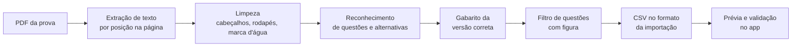

# Origem e tratamento das questões

Como o banco de questões do projeto foi formado e quais problemas apareceram no caminho.

## Contexto

Não existe um conjunto de dados aberto (CSV/JSON com licença livre) de questões da VUNESP ou do TJSP. Os grandes bancos comerciais são fechados, e copiar o conteúdo deles viola os termos de uso. O caminho legítimo e gratuito foi usar as **provas anteriores em PDF**, que as bancas divulgam publicamente, e transformá-las em dados estruturados.

Foram tratadas as três edições mais recentes encontradas do cargo (2014, 2015 e 2017), com cem questões cada.

## Resultado

| Edição | Questões na prova | Aproveitadas | Descartadas |
|---|---|---|---|
| 2014 | 100 | 86 | 14 |
| 2015 | 100 | 86 | 14 |
| 2017 | 100 | 85 | 15 |

As 257 questões aproveitadas foram distribuídas pelas 11 matérias do edital. As descartadas dependem de figura, gráfico, charge ou tabela, cujo conteúdo visual não vem na extração de texto.

## O pipeline

A conversão é uma ferramenta de linha de comando em Node.js (`scripts/pdf-to-csv.mjs`), com o parser separado em `scripts/lib/provaParser.mjs` para poder ser testado sem PDFs.

## Problemas reais e como foram resolvidos

| Problema | Solução |
|---|---|
| **Duas colunas por página**: o texto sai misturado. | Cada palavra é agrupada por posição; as colunas são lidas separadamente, esquerda e depois direita. |
| **Ordem de leitura trocada** (a questão 42 aparecia antes da 41). | O parser aceita um número ainda não visto logo à frente, em vez de exigir a sequência estrita. |
| **Capa confundida com a questão 1** ("001. PROVA OBJETIVA"). | Números de três dígitos começando em zero são ignorados. |
| **Textos-base compartilhados** ("Leia o texto para responder às questões 01 a 09"). | O texto é detectado, mesmo quando a frase quebra em várias linhas, e anexado ao enunciado de cada questão do intervalo. |
| **Títulos de seção** colando na última alternativa ("... MATEMÁTICA"). | Linhas em caixa-alta encerram a alternativa em andamento. |
| **Cabeçalhos e rodapés** com código do caderno e número de página. | Linhas repetidas em metade das páginas e padrões de rodapé são removidos. |
| **Marca d'água "RASCUNHO"** misturada em letras soltas no texto. | Fragmentos da palavra são removidos na limpeza final. |
| **Palavras partidas** no fim da linha ("obri gatório"), às vezes sem o hífen no PDF. | Religação por vocabulário construído do próprio PDF: só junta se a palavra inteira existe no texto. |
| **Várias versões do caderno**, cada uma com gabarito diferente. | Escolha da versão por questões de resposta conhecida (ex.: a de 2014 era a versão 4). |
| **Questões com figura ou alternativas vazias.** | Detectadas por palavras como "gráfico", "figura", "charge" e por alternativas sem texto, e listadas no relatório em vez de importadas quebradas. |

## Como a qualidade foi verificada

- Toda linha gerada passa pelo **mesmo validador da tela de importação** do app (matéria existente, 5 alternativas, gabarito A–E).
- Varredura automática por resíduos: marca d'água, rodapé, caracteres inválidos e palavras hifenizadas não unidas.
- **Conferência de respostas conhecidas** em cada edição (por exemplo, questões de Direito cuja resposta é inequívoca) para confirmar que o gabarito certo foi associado à prova certa.

## Limitações assumidas

- O gabarito usado é o divulgado logo após a prova, e não necessariamente o definitivo pós-recursos. Questões anuladas ou alteradas depois podem estar com a letra desatualizada.
- A divisão por matéria é inferida pelos cabeçalhos e pelo conteúdo, com margem de uma questão nas fronteiras.
- Restam poucas palavras partidas, quase todas na edição de 2015.
- O número original da questão não é gravado, então a ordem original da prova não é preservada dentro de cada edição (previsto no roadmap).

## Direitos autorais

As questões pertencem às bancas. Elas são usadas **apenas para estudo pessoal** e ficam somente no banco privado do usuário no Supabase. Nenhuma questão real está neste repositório; as capturas de tela usam exemplos escritos para a documentação.
